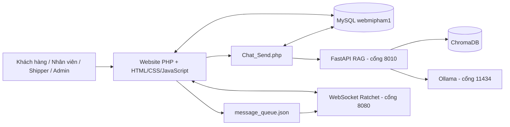
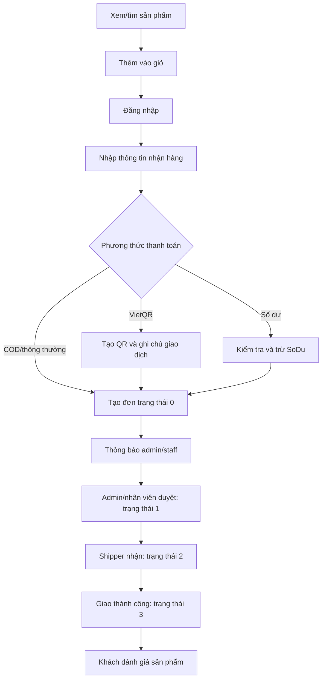
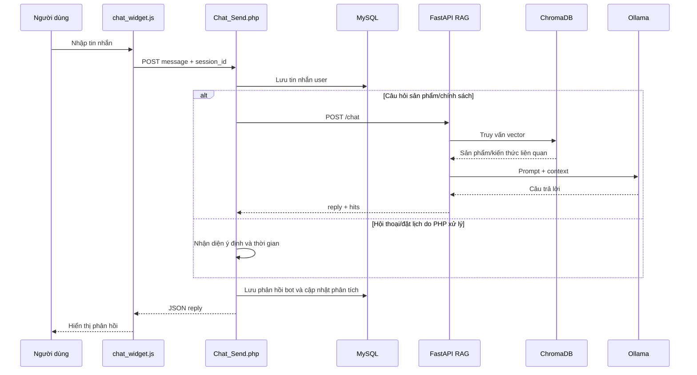
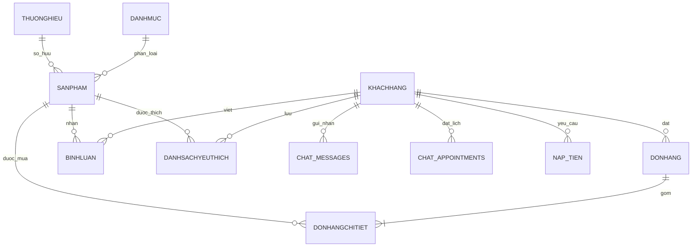

# BÁO CÁO TỔNG QUAN VÀ PHÂN TÍCH CHI TIẾT DỰ ÁN

## WEBSITE BÁN HÀNG MỸ PHẨM TÍCH HỢP CHATBOT AI OLLAMA

> Tên giao diện/thương hiệu xuất hiện trong mã nguồn: **Mơ Shop**  
> Thư mục dự án được khảo sát: `TTTT1`  
> Ngày khảo sát mã nguồn: **15/08/2026**  
> Phạm vi: mã nguồn PHP, JavaScript, Python, WebSocket, cơ sở dữ liệu SQL, ChromaDB và các tệp cấu hình có trong thư mục dự án.  
> Lưu ý: báo cáo này được tạo bằng cách đọc mã nguồn, không chỉnh sửa logic hay mã nguồn của hệ thống.

---

## Mục lục

1. [Tóm tắt điều hành](#1-tóm-tắt-điều-hành)
2. [Giới thiệu dự án](#2-giới-thiệu-dự-án)
3. [Mục tiêu và phạm vi hệ thống](#3-mục-tiêu-và-phạm-vi-hệ-thống)
4. [Kiến trúc tổng thể](#4-kiến-trúc-tổng-thể)
5. [Cấu trúc thư mục](#5-cấu-trúc-thư-mục)
6. [Công nghệ và thư viện sử dụng](#6-công-nghệ-và-thư-viện-sử-dụng)
7. [Tác nhân và phân quyền](#7-tác-nhân-và-phân-quyền)
8. [Phân tích chức năng phía khách hàng](#8-phân-tích-chức-năng-phía-khách-hàng)
9. [Phân tích chức năng nhân viên, shipper và quản trị](#9-phân-tích-chức-năng-nhân-viên-shipper-và-quản-trị)
10. [Quy trình nghiệp vụ chính](#10-quy-trình-nghiệp-vụ-chính)
11. [Chatbot AI Ollama và hệ thống RAG](#11-chatbot-ai-ollama-và-hệ-thống-rag)
12. [Thu thập và phân tích thông tin khách hàng](#12-thu-thập-và-phân-tích-thông-tin-khách-hàng)
13. [Hệ thống thông báo thời gian thực WebSocket](#13-hệ-thống-thông-báo-thời-gian-thực-websocket)
14. [Thiết kế cơ sở dữ liệu](#14-thiết-kế-cơ-sở-dữ-liệu)
15. [Dữ liệu hiện có trong bản sao SQL](#15-dữ-liệu-hiện-có-trong-bản-sao-sql)
16. [Các API và điểm xử lý quan trọng](#16-các-api-và-điểm-xử-lý-quan-trọng)
17. [Cài đặt và vận hành hệ thống](#17-cài-đặt-và-vận-hành-hệ-thống)
18. [Trạng thái thực tế tại thời điểm khảo sát](#18-trạng-thái-thực-tế-tại-thời-điểm-khảo-sát)
19. [Ưu điểm của dự án](#19-ưu-điểm-của-dự-án)
20. [Hạn chế, rủi ro và vấn đề kỹ thuật](#20-hạn-chế-rủi-ro-và-vấn-đề-kỹ-thuật)
21. [Đề xuất hoàn thiện và hướng phát triển](#21-đề-xuất-hoàn-thiện-và-hướng-phát-triển)
22. [Kịch bản kiểm thử đề xuất](#22-kịch-bản-kiểm-thử-đề-xuất)
23. [Kết luận](#23-kết-luận)
24. [Phụ lục](#24-phụ-lục)

---

## 1. Tóm tắt điều hành

Dự án là một hệ thống thương mại điện tử bán mỹ phẩm được xây dựng chủ yếu bằng PHP thuần, MySQL, HTML/CSS/JavaScript và Bootstrap. Ngoài các chức năng bán hàng cơ bản, dự án đã mở rộng thành một hệ thống nhiều vai trò gồm khách hàng, nhân viên, shipper, quản lý và quản trị viên.

Điểm nổi bật nhất của dự án là tích hợp chatbot tư vấn mỹ phẩm chạy bằng Ollama kết hợp kỹ thuật RAG. Chatbot sử dụng mô hình ngôn ngữ `llama3.1:8b`, mô hình embedding `BAAI/bge-m3` và cơ sở dữ liệu vector ChromaDB. Dữ liệu vector hiện có gồm 18 mục sản phẩm và 15 mục kiến thức cửa hàng.

Hệ thống đã có khả năng:

- Quản lý sản phẩm, danh mục, thương hiệu và bài viết.
- Đăng ký, đăng nhập, xác thực email bằng mã OTP.
- Đăng ký trở thành shipper hoặc nhân viên và chờ quản trị viên phê duyệt.
- Quản lý giỏ hàng, yêu thích, bình luận và đánh giá sản phẩm.
- Đặt hàng bằng COD/luồng thông thường, VietQR hoặc số dư tài khoản.
- Theo dõi trạng thái đơn hàng từ chờ duyệt đến giao thành công.
- Hủy đơn, yêu cầu hoàn trả/hoàn tiền và đính kèm bằng chứng.
- Nạp tiền vào số dư và chờ quản trị xác nhận.
- Chat với trợ lý AI, lưu tin nhắn hai chiều và đặt lịch tư vấn.
- Ghi nhận khách vãng lai, nhu cầu, sản phẩm quan tâm và phân loại khách hàng.
- Gửi thông báo thời gian thực cho từng nhóm người dùng bằng WebSocket.
- Cung cấp trang quản trị, thống kê, biểu đồ và xuất dữ liệu CSV.

Tuy nhiên, trạng thái hiện tại cho thấy dự án vẫn thiên về môi trường phát triển/đồ án hơn là hệ thống sẵn sàng triển khai thực tế. Các dịch vụ Ollama, FastAPI và WebSocket không chạy tại thời điểm khảo sát; đường dẫn ChromaDB trong `.env` không đúng với vị trí hiện tại; schema cơ sở dữ liệu được tạo rải rác trong mã PHP; mật khẩu còn lưu dạng văn bản thuần; một số câu SQL được ghép chuỗi trực tiếp; và chưa có bộ kiểm thử tự động.

### Kết luận nhanh theo ba nội dung trọng tâm

| Nội dung | Trạng thái | Bằng chứng chính |
|---|---|---|
| Chatbot Ollama | Đã tích hợp trong mã, có dữ liệu RAG; hiện chưa chạy | `api_rag_ollama.py`, `Chat_Send.php`, ChromaDB |
| Thu thập thông tin khách hàng | Đã có ở nhiều mức: tài khoản, hành vi chat, nhu cầu, lịch hẹn, khách vãng lai, phân loại | `customer_analysis`, `guest_customers`, `customer_needs`, `lead_scores` |
| Lưu lịch sử chat | Đã triển khai và bản dump có dữ liệu thực tế | 429 bản ghi trong `chat_messages` |

---

## 2. Giới thiệu dự án

### 2.1. Tên và loại hệ thống

- Loại hệ thống: website thương mại điện tử bán mỹ phẩm.
- Tên hiển thị trong giao diện: Mơ Shop.
- Mô hình triển khai hiện tại: ứng dụng web PHP chạy trên máy chủ cục bộ, MySQL làm cơ sở dữ liệu, Python/FastAPI phục vụ AI và một tiến trình PHP riêng phục vụ WebSocket.
- Định hướng: kết hợp bán hàng, chăm sóc khách hàng, tư vấn bằng AI và quản lý quy trình giao hàng.

### 2.2. Bài toán mà dự án giải quyết

Khách hàng mua mỹ phẩm thường cần nhiều thông tin hơn so với các sản phẩm thông thường, chẳng hạn loại da phù hợp, công dụng, giá, thương hiệu và sự khác biệt giữa các sản phẩm. Dự án giải quyết bài toán này bằng hai lớp:

1. Website thương mại điện tử hỗ trợ tra cứu và mua hàng.
2. Chatbot AI truy xuất dữ liệu thật của cửa hàng để tư vấn và có thể chuyển tiếp khách hàng sang lịch tư vấn với nhân viên.

Ngoài ra, hệ thống thu thập hành vi tương tác nhằm xác định khách hàng tiềm năng và hỗ trợ nhân viên chăm sóc khách hàng tốt hơn.

### 2.3. Đối tượng sử dụng

- Khách chưa đăng nhập.
- Khách hàng có tài khoản.
- Nhân viên cửa hàng (`employee`).
- Người giao hàng (`shipper`).
- Quản lý (`manager`).
- Quản trị viên (`admin`).

---

## 3. Mục tiêu và phạm vi hệ thống

### 3.1. Mục tiêu nghiệp vụ

- Số hóa quá trình giới thiệu và bán sản phẩm mỹ phẩm.
- Hỗ trợ khách hàng tìm kiếm, so sánh và lựa chọn sản phẩm.
- Giảm tải tư vấn viên bằng chatbot hoạt động cục bộ qua Ollama.
- Lưu lại lịch sử tương tác để phục vụ chăm sóc khách hàng.
- Quản lý đầy đủ vòng đời đơn hàng.
- Phân chia công việc giữa admin, nhân viên và shipper.
- Theo dõi khách hàng tiềm năng dựa trên hành vi chat, đặt lịch và mua hàng.
- Cung cấp thông báo tức thời khi trạng thái hệ thống thay đổi.

### 3.2. Phạm vi chức năng

Phạm vi hiện tại bao gồm:

- Danh mục sản phẩm và nội dung giới thiệu.
- Tài khoản và hồ sơ người dùng.
- Thương mại điện tử và thanh toán.
- Quản trị hàng hóa và đơn hàng.
- Giao hàng và xác nhận thanh toán.
- Hoàn trả/hoàn tiền.
- Chatbot, lịch tư vấn và phân tích khách hàng.
- Thông báo thời gian thực.
- Báo cáo, biểu đồ và xuất CSV.

### 3.3. Ngoài phạm vi hoặc chưa hoàn chỉnh

- Chưa thấy tích hợp cổng thanh toán có webhook xác nhận giao dịch tự động.
- VietQR hiện chủ yếu tạo mã QR và ghi nhận nội dung; chưa thấy luồng đối soát ngân hàng tự động.
- Chưa có hệ thống kiểm thử tự động.
- Chưa có cấu hình triển khai production bằng Docker, CI/CD hoặc reverse proxy.
- Chưa có cơ chế quản lý migration cơ sở dữ liệu thống nhất.

---

## 4. Kiến trúc tổng thể

### 4.1. Sơ đồ thành phần



### 4.2. Các lớp chính

#### Lớp giao diện

- Website người dùng tại `TTTT/WebBanHangMyPham`.
- Giao diện quản trị tại `TTTT/AdminManage`.
- Bootstrap, jQuery, Slick Carousel, Font Awesome và JavaScript tự viết.

#### Lớp xử lý nghiệp vụ

- Các trang PHP trong `src/View` vừa hiển thị vừa thực hiện một phần truy vấn.
- Các endpoint trong `src/Processing` xử lý AJAX, biểu mẫu, đặt hàng, chat, hồ sơ và thông báo.
- Kiến trúc mang tính PHP thuần, chưa tách thành framework MVC hoàn chỉnh.

#### Lớp dữ liệu

- MySQL database: `webmipham1`.
- Kết nối mặc định: `localhost`, người dùng `root`, mật khẩu rỗng.
- ChromaDB lưu vector sản phẩm và kiến thức cho chatbot.
- `localStorage` và cookie lưu cache/session chatbot phía trình duyệt.

#### Lớp AI

- FastAPI làm cầu nối giữa PHP và Ollama.
- Sentence Transformers tạo vector câu hỏi.
- ChromaDB tìm các đoạn dữ liệu liên quan.
- Ollama tạo câu trả lời cuối cùng dựa trên prompt và dữ liệu truy xuất.

#### Lớp realtime

- Ratchet WebSocket server tại cổng `8080`.
- Trình duyệt đăng ký vào channel theo vai trò.
- Backend ghi thông báo vào `message_queue.json`; server đọc hàng đợi và broadcast.

---

## 5. Cấu trúc thư mục

```text
TTTT1/
├── .env.example.txt                  # Cấu hình môi trường mẫu
├── check_chroma.py                   # Công cụ kiểm tra ChromaDB
├── requirements_global.txt           # Danh sách package Python toàn cục
├── webmipham1.sql                    # Bản sao cơ sở dữ liệu chính
├── Vietnamese-Administrative-Units-Dataset.*
│                                       # Dữ liệu tỉnh/thành, quận/huyện Việt Nam
├── DoAnCoSo_4_VKU.docx               # Tài liệu đồ án có sẵn
├── RealtimeServer.docx               # Tài liệu về realtime server
├── venv/                             # Môi trường Python cục bộ
└── TTTT/
    ├── composer.json                 # PHPMailer và dotenv
    ├── vendor/                       # Dependency Composer gốc
    ├── imgs/                         # Tài nguyên ảnh giao diện/sản phẩm
    ├── Image_upload/                 # Ảnh được tải lên
    ├── sanpham.csv                   # Dữ liệu sản phẩm CSV
    ├── WebBanHangMyPham/
    │   ├── CSS/                      # CSS tự viết
    │   ├── JS/                       # JavaScript giao diện, chatbot, WebSocket
    │   ├── IMG/, Image_upload/       # Ảnh website
    │   ├── LIB/Bootstrap/            # Bootstrap cục bộ
    │   └── src/
    │       ├── DB_Connect.php        # Kết nối MySQL
    │       ├── Layouts/              # Header, footer, navbar, widget chat...
    │       ├── View/                 # Các màn hình người dùng/nhân viên/shipper
    │       ├── Processing/           # Endpoint và xử lý nghiệp vụ
    │       ├── ML/                   # FastAPI, ingest RAG, knowledge, requirements
    │       └── RAG/chroma_cosmetics/ # Cơ sở dữ liệu vector ChromaDB
    ├── AdminManage/
    │   ├── css/, js/, scss/          # SB Admin 2
    │   ├── vendor/                   # Thư viện frontend admin
    │   └── src/
    │       ├── View/                 # Đăng nhập admin
    │       ├── Layouts/              # Layout và kiểm soát truy cập
    │       ├── Products/             # Quản lý sản phẩm
    │       ├── Categorys/            # Quản lý danh mục
    │       ├── Brands/               # Quản lý thương hiệu
    │       ├── News_Posts/           # Quản lý bài viết
    │       ├── Comments/             # Quản lý bình luận
    │       ├── Oders/                # Quản lý đơn hàng/hoàn trả
    │       └── Users/                # Người dùng, phân tích, shipper, nạp tiền
    └── WebSocketServer/
        ├── server.php                # Khởi động server cổng 8080
        ├── src/RealtimeServer.php    # Quản lý kết nối và channel
        ├── WebSocket_Push.php        # Hàm tạo thông báo
        ├── broadcast.php             # Endpoint đưa thông báo vào queue
        ├── message_queue.json        # Hàng đợi file JSON
        └── start_server.bat/.sh      # Script khởi động
```

---

## 6. Công nghệ và thư viện sử dụng

### 6.1. Backend website

| Công nghệ | Vai trò |
|---|---|
| PHP thuần | Xử lý giao diện, session, nghiệp vụ và truy vấn dữ liệu |
| MySQL/MariaDB | Lưu tài khoản, sản phẩm, đơn hàng, chat và dữ liệu phân tích |
| MySQLi | Kết nối chính trong phần lớn website |
| PDO | Sử dụng trong các module chat, phân tích và thông báo |
| Composer | Quản lý dependency PHP |
| PHPMailer | Gửi mã xác thực email |
| `vlucas/phpdotenv` | Đọc biến môi trường ở cấp dự án |

### 6.2. Frontend

| Công nghệ | Vai trò |
|---|---|
| HTML5/CSS3 | Giao diện |
| JavaScript | Xử lý tương tác, AJAX, chatbot, thông báo |
| jQuery 3.6 | AJAX và thao tác DOM |
| Bootstrap 5 | Giao diện website khách hàng |
| Bootstrap 4.6 / SB Admin 2 | Giao diện quản trị |
| Font Awesome | Biểu tượng |
| Slick Carousel | Slider/banner/sản phẩm |
| Chart.js | Biểu đồ thống kê |
| DataTables | Bảng dữ liệu quản trị |
| CKEditor 5 | Soạn nội dung bài viết |

### 6.3. AI và xử lý dữ liệu

| Công nghệ | Vai trò |
|---|---|
| Python | Chạy dịch vụ AI và ingest dữ liệu |
| FastAPI | Cung cấp endpoint `/chat`, `/ping`, `/warm` |
| Uvicorn | Máy chủ ASGI cho FastAPI |
| Ollama | Chạy mô hình ngôn ngữ cục bộ |
| `llama3.1:8b` | Mô hình sinh câu trả lời mặc định |
| Sentence Transformers | Tạo embedding |
| `BAAI/bge-m3` | Mô hình embedding mặc định |
| ChromaDB | Cơ sở dữ liệu vector |
| LangDetect | Phân biệt tiếng Việt/tiếng Anh |
| pandas | Xuất/ingest dữ liệu sản phẩm |

### 6.4. Realtime

| Công nghệ | Vai trò |
|---|---|
| Ratchet | WebSocket server bằng PHP |
| React Socket | Socket event loop |
| Browser WebSocket API | Client realtime |
| Notification API | Thông báo hệ điều hành/trình duyệt |
| JSON file queue | Trung gian truyền sự kiện backend → WebSocket server |

---

## 7. Tác nhân và phân quyền

### 7.1. Các vai trò

| Vai trò | Mã role | Quyền chính |
|---|---|---|
| Khách vãng lai | Không có tài khoản | Xem sản phẩm, chat, cung cấp thông tin và đặt lịch |
| Khách hàng | `customer` | Mua hàng, theo dõi đơn, đánh giá, yêu thích, quản lý hồ sơ |
| Shipper | `shipper` | Nhận đơn đã duyệt, cập nhật giao hàng, xác nhận thanh toán |
| Nhân viên | `employee` | Dashboard nhân viên, duyệt đơn, xem khách hàng, xử lý lịch/hoàn trả theo quyền |
| Quản lý | `manager` | Truy cập gần tương đương admin |
| Quản trị viên | `admin` | Quản lý toàn bộ dữ liệu và quy trình |

### 7.2. Hai hệ thống session đăng nhập

Dự án chủ động tách hai ngữ cảnh đăng nhập:

- Website người dùng dùng các session như `user`, `IDNguoiDung`, `user_role`.
- Admin panel dùng `admin_user`, `admin_id`, `admin_role`, `admin_is_admin`.

Mục đích của thiết kế này là tránh việc đăng nhập website thông thường tự động cấp quyền vào admin panel. Nhân viên phải đăng nhập riêng qua `Admin_Login.php` để sử dụng chức năng nội bộ.

### 7.3. Kiểm soát truy cập admin

Tệp `AdminManage/src/Layouts/Admin_Access_Check.php` định nghĩa nhóm trang cho shipper, nhân viên và admin. Nhân viên bị hạn chế ở các trang dashboard, khách hàng, phân tích và duyệt đơn; các trang chuẩn bị hàng, xóa đơn, chuyển giao và hoàn tất được xác định là nhóm hạn chế hơn.

### 7.4. Quy trình đăng ký nhân viên/shipper

- Người dùng chọn đăng ký `customer`, `shipper` hoặc `employee`.
- Email phải qua mã xác nhận 6 chữ số.
- Shipper/employee cung cấp thêm thông tin hồ sơ, địa chỉ, phương tiện, giấy tờ tùy thân và vị trí làm việc tùy vai trò.
- Thông tin được ghi vào `shipper_requests` với trạng thái chờ duyệt.
- Tài khoản shipper chưa được duyệt không thể sử dụng chức năng giao hàng.

---

## 8. Phân tích chức năng phía khách hàng

### 8.1. Trang chủ

Trang `src/View/index.php` kết hợp nhiều layout:

- Banner chính.
- Slider danh mục.
- Slider thương hiệu.
- Sản phẩm mới.
- Sản phẩm nổi bật.
- Banner khuyến mại.
- Bài viết/tin tức.
- Header, navbar, footer và chatbot dùng chung.

### 8.2. Danh sách và chi tiết sản phẩm

Các trang chính:

- `View_Product.php`: danh sách sản phẩm.
- `Detail_Product.php`: thông tin chi tiết.
- `Get_Product_Detail.php`: lấy dữ liệu chi tiết phục vụ AJAX.

Thông tin sản phẩm gồm tên, danh mục, thương hiệu, số lượng, giá, mô tả, ảnh, trạng thái nổi bật và thời gian tạo/cập nhật.

### 8.3. Danh mục và thương hiệu

Website có 9 danh mục và 12 thương hiệu trong bản dump. Giao diện dùng slider để giúp khách duyệt nhanh theo nhóm sản phẩm hoặc hãng.

### 8.4. Tìm kiếm và lọc

Việc duyệt sản phẩm được hỗ trợ bởi các trang danh sách, tham số trên URL và các truy vấn PHP. Chatbot đóng vai trò tìm kiếm ngữ nghĩa bổ sung bằng cách chuyển câu hỏi tự nhiên thành truy vấn vector.

### 8.5. Giỏ hàng

- JavaScript `scrip_Cart.js` hỗ trợ tương tác giỏ hàng.
- Trang `Cart.php` hiển thị sản phẩm, số lượng và tổng tiền.
- Dữ liệu giỏ hàng được truyền sang checkout.
- Hệ thống kiểm tra người dùng và số dư khi chọn thanh toán bằng tài khoản.

### 8.6. Danh sách yêu thích

- Thêm sản phẩm vào `danhsachyeuthich`.
- Kiểm tra trùng sản phẩm theo cặp khách hàng–sản phẩm.
- Cho phép xóa sản phẩm khỏi danh sách.
- Trang `View_ListLike.php` hiển thị danh sách yêu thích.

### 8.7. Bình luận và đánh giá

#### Bình luận

- Lưu nội dung vào `binhluan`.
- Có cờ `DaMuaHang` để phân biệt người đã mua sản phẩm.
- Quản trị viên có trang quản lý và xóa bình luận.

#### Đánh giá sao

- Cho phép đánh giá từ 1 đến 5 sao.
- Bảng `danhgia` được tạo động khi cần.
- Mỗi khách chỉ có một đánh giá cho một sản phẩm; đánh giá lại sẽ cập nhật bản ghi cũ.
- Hệ thống kiểm tra đơn giao thành công để nhắc khách đánh giá.

### 8.8. Đăng ký và xác thực email

- Nhập họ tên, email, số điện thoại, địa chỉ, tài khoản và mật khẩu.
- Gửi OTP qua PHPMailer, SMTP hoặc `mail()` fallback.
- OTP có thời hạn 30 phút và được đánh dấu đã dùng.
- Giao diện có thời gian chờ gửi lại mã.
- Có luồng hiển thị mã/link mã trong môi trường phát triển khi gửi email thất bại.

### 8.9. Đăng nhập

- Tra cứu tài khoản trong bảng `khachhang`.
- Ghi `IDNguoiDung`, tên tài khoản và role vào session.
- Shipper phải có yêu cầu đăng ký ở trạng thái `approved`.
- Sau đăng nhập, website vẫn giữ người dùng ở giao diện khách hàng; admin panel có đăng nhập riêng.

### 8.10. Hồ sơ cá nhân

- Xem và cập nhật họ tên, email, số điện thoại, địa chỉ, avatar.
- Hiển thị số dư tài khoản.
- Theo dõi đơn hàng và lịch sử hoạt động liên quan.
- Việc cập nhật hồ sơ có thể tạo thông báo realtime cho admin.

### 8.11. Nạp tiền vào tài khoản

- Khách tạo yêu cầu nạp tiền qua `Create_Deposit.php`.
- Dữ liệu được lưu trong bảng `nap_tien` với trạng thái chờ.
- Admin có thể xác nhận hoặc từ chối.
- Khi xác nhận, số dư `SoDu` của khách được cập nhật.
- Yêu cầu mới tạo thông báo realtime cho admin.

### 8.12. Thanh toán

Hệ thống có ba hướng thanh toán chính:

1. Đặt hàng thông thường/COD.
2. Thanh toán bằng VietQR.
3. Thanh toán bằng số dư tài khoản.

Khi thanh toán bằng số dư:

- Kiểm tra số dư mới nhất.
- Từ chối nếu không đủ.
- Trừ số dư trước khi tạo đơn.
- Nếu tạo đơn hoặc chi tiết đơn thất bại, hệ thống có logic hoàn lại số dư.
- Đơn được đánh dấu `DaThanhToan = 1` khi phù hợp.

### 8.13. Theo dõi và hủy đơn

Trang `Order_Tracking.php` hiển thị trạng thái:

| Giá trị | Ý nghĩa |
|---:|---|
| `0` | Cần duyệt |
| `1` | Chuẩn bị hàng/đã duyệt |
| `2` | Đang giao |
| `3` | Giao thành công |
| `-1` hoặc ghi chú `[ĐÃ HỦY]` | Đã hủy |

Khách có thể hủy khi đơn chưa chuyển sang giai đoạn giao. Luồng hủy yêu cầu lý do và xử lý hoàn số dư tùy phương thức thanh toán.

### 8.14. Hoàn trả và hoàn tiền

- Khách tạo yêu cầu từ `Return_Refund_Request.php`.
- Chọn loại yêu cầu, lý do, mô tả và phương thức hoàn tiền.
- Có thể tải ảnh/video bằng chứng.
- Khách theo dõi tại `My_Return_Requests.php`.
- Trạng thái cơ bản: `pending`, `approved`, `rejected`.
- Admin hoặc nhân viên xem chi tiết, duyệt/từ chối và xử lý số dư/đơn hàng.

### 8.15. Tin tức, chính sách và liên hệ

- Danh sách và chi tiết bài viết.
- Trang giới thiệu và liên hệ.
- Chính sách giao hàng, đổi trả, quy định và khiếu nại.
- Form liên hệ lưu họ tên, email, số điện thoại và nội dung vào `contact_messages`.

### 8.16. Chatbot tư vấn

Widget “Mơ Shop Chat” xuất hiện trong layout chung. Khách có thể:

- Gửi câu hỏi tiếng Việt hoặc tiếng Anh.
- Tìm sản phẩm bằng ngôn ngữ tự nhiên.
- Hỏi thông tin cửa hàng/chính sách.
- So sánh sản phẩm.
- Đặt lịch tư vấn.
- Tải lại lịch sử chat từ cơ sở dữ liệu.
- Tiếp tục chat khi chưa đăng nhập thông qua cookie `chat_session_id`.

---

## 9. Phân tích chức năng nhân viên, shipper và quản trị

### 9.1. Quản lý sản phẩm

- Danh sách, thêm, sửa, xóa và xem chi tiết sản phẩm.
- Tải ảnh đại diện và ảnh bổ sung.
- Quản lý giá, tồn kho, danh mục, thương hiệu và trạng thái nổi bật.
- Gửi thông báo realtime khi sản phẩm được thêm/sửa/xóa.

### 9.2. Quản lý danh mục và thương hiệu

- CRUD danh mục.
- CRUD thương hiệu.
- Quản lý ảnh danh mục/thương hiệu.
- Phát thông báo cập nhật sang staff và user channel.

### 9.3. Quản lý bài viết

- CRUD bài viết tin tức.
- CKEditor phục vụ soạn nội dung dài.
- Quản lý ảnh bài viết.
- Phát thông báo khi nội dung thay đổi.

### 9.4. Quản lý người dùng

- Danh sách khách hàng.
- Xem chi tiết, sửa, xóa.
- Xuất danh sách CSV.
- Xem hoạt động và các thông tin mua hàng liên quan.
- Nhận thông báo khi khách cập nhật hồ sơ.

### 9.5. Quản lý đơn hàng

Các nhóm trang gồm:

- Đơn cần duyệt.
- Tất cả đơn.
- Chuẩn bị hàng.
- Đang giao.
- Đã giao thành công.
- Đơn bị hủy.
- Xem chi tiết.
- Đánh dấu đã thanh toán.
- Xóa đơn có xử lý hoàn số dư.

Nhân viên có thể duyệt đơn thay admin. Khi đơn được duyệt, shipper channel nhận thông báo để nhận đơn.

### 9.6. Chức năng shipper

- Xem đơn đã duyệt có thể nhận.
- Nhận/gán đơn cho chính mình thông qua `ID_Shipper`.
- Chuyển đơn sang đang giao.
- Xác nhận giao thành công.
- Xác nhận đã thu tiền/thanh toán.
- Xem lịch sử đơn đã giao.
- Admin có trang thống kê hiệu suất shipper và chi tiết từng shipper.

### 9.7. Quản lý đăng ký shipper/nhân viên

- Xem hồ sơ đăng ký và giấy tờ.
- Phê duyệt hoặc từ chối.
- Cập nhật role phù hợp.
- Gửi thông báo trực tiếp tới tài khoản được duyệt.

### 9.8. Quản lý hoàn trả/hoàn tiền

- Danh sách yêu cầu hoàn trả/hủy đơn.
- Xem lý do, hình ảnh/video và thông tin ngân hàng/hoàn số dư.
- Duyệt hoặc từ chối yêu cầu.
- Cập nhật trạng thái đơn.
- Hoàn tiền vào số dư nếu quy trình yêu cầu.

### 9.9. Quản lý chatbot và khách hàng

- Xem tin nhắn khách hàng.
- Xem lịch tư vấn.
- Xem khách vãng lai.
- Xem lịch sử chat theo session.
- Xem phân tích khách hàng theo nhãn.
- Hiển thị biểu đồ cột và tròn cho `spam`, `follow-up`, `potential`.
- Xuất tin nhắn, lịch hẹn và phân tích ra CSV.

### 9.10. Dashboard và báo cáo

- Analytics tổng quan.
- Thống kê khách hàng.
- Thống kê shipper.
- Thống kê khách hàng theo tuần.
- Bộ lọc theo nhãn/tuần.
- Tổng doanh thu và số lượng theo nhóm.
- DataTables hỗ trợ tìm kiếm, sắp xếp và phân trang.

---

## 10. Quy trình nghiệp vụ chính

### 10.1. Quy trình mua hàng



### 10.2. Quy trình chatbot



### 10.3. Quy trình đặt lịch tư vấn

1. Khách hỏi sản phẩm hoặc thể hiện nhu cầu tư vấn.
2. Chatbot đề nghị đặt lịch.
3. Nếu khách đồng ý, giao diện hiển thị biểu mẫu ngày/giờ.
4. Với khách chưa đăng nhập, biểu mẫu thu thêm tên, số điện thoại và địa chỉ.
5. PHP phân tích ngày giờ theo định dạng Việt Nam.
6. Lịch được lưu vào `chat_appointments`.
7. Hồ sơ `customer_analysis` được nâng thành `potential` và đánh dấu có lịch hẹn.

### 10.4. Quy trình hoàn trả

1. Khách chọn đơn đủ điều kiện.
2. Gửi lý do và bằng chứng.
3. Yêu cầu ở trạng thái `pending`.
4. Nhân viên/admin kiểm tra.
5. Yêu cầu được `approved` hoặc `rejected`.
6. Nếu duyệt, đơn được ghi nhận hoàn trả và tiền được xử lý theo phương thức phù hợp.

### 10.5. Quy trình đánh giá khách hàng theo tuần

Hệ thống `Customer_Weekly_Evaluation.php` sử dụng tổng mua hàng, chat và lịch tư vấn:

- Mua trên 5.000.000 đồng/tuần: `potential`, ưu đãi 20%.
- Khách potential tiếp tục mua trên 1.000.000 đồng/tuần: duy trì potential, ưu đãi 10%.
- Có lịch/chat nhưng không đạt tiêu chí mua: có thể là `follow-up`.
- Không có tín hiệu giá trị: `spam` theo tên nhãn hiện tại của mã.
- Kết quả được lưu theo từng tuần và tạo thông báo cho khách.

---

## 11. Chatbot AI Ollama và hệ thống RAG

### 11.1. Thành phần

| Thành phần | Tệp/vị trí | Chức năng |
|---|---|---|
| Giao diện chat | `Layouts/Chat_Widget.php` | Khung chat và form |
| Logic trình duyệt | `JS/chat_widget.js` | Session, cache, gửi/nhận, render |
| Backend chat | `Processing/Chat_Send.php` | Lưu tin, nhận diện intent, gọi RAG |
| Lịch sử | `Processing/Chat_History.php` | Tải lại tin nhắn |
| API AI | `ML/api_rag_ollama.py` | FastAPI, retrieve, prompt, gọi Ollama |
| Ingest sản phẩm | `ML/ingest_rag.py` | Đưa sản phẩm vào ChromaDB |
| Ingest kiến thức | `ML/ingest_knowledge.py` | Đưa FAQ/chính sách vào ChromaDB |
| Knowledge | `ML/shop_knowledge.json` | Kiến thức cửa hàng |
| Vector DB | `src/RAG/chroma_cosmetics` | Vector và metadata |

### 11.2. Cấu hình AI

- `OLLAMA_HOST`: `http://127.0.0.1:11434`.
- `OLLAMA_MODEL`: `llama3.1:8b`.
- `EMB_MODEL`: `BAAI/bge-m3`.
- FastAPI: `127.0.0.1:8010`.
- Endpoint Ollama: `/api/chat`.
- API sử dụng `requests.Session()` để giữ kết nối HTTP.
- Có timeout, temperature, context length và số thread cấu hình bằng biến môi trường.

### 11.3. Dữ liệu RAG hiện có

Kiểm tra trực tiếp file Chroma SQLite ở chế độ chỉ đọc cho kết quả:

| Collection | Số embedding |
|---|---:|
| `cosmetics_products` | 18 |
| `shop_knowledge` | 15 |

Điều này chứng minh dữ liệu đã từng được ingest, không chỉ có mã khung.

### 11.4. Luồng truy xuất

1. Nhận câu hỏi.
2. Phát hiện ngôn ngữ.
3. Xác định câu hỏi về sản phẩm, FAQ hoặc thông tin cửa hàng.
4. Mã hóa câu hỏi thành embedding.
5. Truy vấn ChromaDB.
6. Lấy tối đa các kết quả phù hợp nhất.
7. Xây dựng prompt có tên, thương hiệu, giá và mô tả.
8. Gửi prompt đến Ollama.
9. Trả lời tiếng Việt hoặc tiếng Anh.

### 11.5. Các loại câu hỏi được hỗ trợ

- Tìm son, kem, serum, mặt nạ, sữa rửa mặt, chống nắng, dưỡng ẩm...
- Tìm sản phẩm theo vấn đề da.
- So sánh hai sản phẩm.
- Tư vấn theo loại da.
- Hỏi giờ làm việc, địa chỉ, hotline, chính sách đổi trả, freeship và thanh toán.
- Hỏi cách sử dụng, độ an toàn và tính phù hợp.

### 11.6. Cơ chế hạn chế hallucination

Prompt yêu cầu mô hình:

- Chỉ dùng dữ liệu được cung cấp.
- Không tự bịa giá hoặc thông tin sản phẩm.
- Hiển thị tên, thương hiệu và giá rõ ràng.
- Chỉ giới thiệu tối đa khoảng hai sản phẩm phù hợp.
- Trả lời ngắn gọn, thân thiện.

### 11.7. Fallback và lỗi

- Nếu Ollama mất kết nối: trả về thông báo mô hình đang bận.
- Nếu embedding/Chroma khởi tạo lỗi: trả thông báo kỹ thuật.
- Nếu không tìm thấy sản phẩm: hỏi thêm nhu cầu khách.
- Một phần thông tin cửa hàng được hard-code làm dữ liệu dự phòng.
- API có endpoint stream `/chat_stream`, nhưng widget hiện dùng endpoint thường `/chat` qua PHP.

### 11.8. Trạng thái hiện tại của AI

- Mã nguồn: có và tương đối đầy đủ.
- Dữ liệu vector: có.
- Ollama tại `11434`: không kết nối được khi khảo sát.
- FastAPI tại `8010`: không kết nối được khi khảo sát.
- Không thấy tiến trình Ollama/Python API đang chạy.
- `.env` đang trỏ `CHROMA_DIR` tới `D:/TTTT1/...`, trong khi vị trí thực tế nằm trong `D:/VKU/DACS/.../TTTT1/...`.

Do đó, chatbot **đã được xây dựng và đã từng có dữ liệu chat sinh bởi bot**, nhưng cần khởi động dịch vụ và sửa cấu hình môi trường trước khi hoạt động ổn định ở vị trí thư mục hiện tại.

---

## 12. Thu thập và phân tích thông tin khách hàng

### 12.1. Các nguồn dữ liệu khách hàng

| Nguồn | Thông tin thu thập |
|---|---|
| Đăng ký tài khoản | Tài khoản, họ tên, email, SĐT, địa chỉ |
| Hồ sơ cá nhân | Avatar, số dư, thông tin cập nhật |
| Đơn hàng | Người nhận, địa chỉ, tổng tiền, sản phẩm, trạng thái |
| Yêu thích | Sản phẩm khách quan tâm |
| Bình luận/đánh giá | Ý kiến và điểm sao |
| Chat | Nội dung câu hỏi, phản hồi bot, thời gian, session |
| Đặt lịch | Thời gian tư vấn, nội dung, thông tin liên hệ |
| Khách vãng lai | Session, tên, SĐT, địa chỉ, email/ghi chú nếu có |
| Phân tích | Nhãn, sản phẩm quan tâm, nhu cầu gần nhất, số tin nhắn |
| Event tracking | Loại sự kiện, metadata, intent |
| Mua hàng tuần | Tổng đơn, doanh số tuần, nhãn và mức giảm giá |

### 12.2. Khách đăng nhập và khách vãng lai

#### Khách đăng nhập

Tin nhắn và hoạt động được gắn `user_id`, cho phép tổng hợp xuyên nhiều phiên chat.

#### Khách vãng lai

- Cookie `chat_session_id` được giữ 365 ngày.
- Nếu chưa có hồ sơ, hệ thống tạo tên tạm dạng “Khách vãng lai #...”.
- Khi đặt lịch, khách được yêu cầu cung cấp tên, SĐT và địa chỉ.
- Admin có thể xem lịch sử chat theo session.

### 12.3. Bảng phân tích khách hàng mới

`customer_analysis` gồm:

- `user_id`.
- `session_id`.
- `label`: `spam`, `follow-up`, `potential`.
- `product_interest`.
- `last_need`.
- `message_count`.
- `has_appointment`.
- `updated_at`.

### 12.4. Quy tắc phân loại trong chat

- Chat xã giao đơn thuần: mặc định có thể là `spam`.
- Có nhu cầu tư vấn/tiếp tục tương tác: `follow-up`.
- Hỏi/tìm sản phẩm: ghi `product_interest`, thường nâng lên `follow-up`.
- Đặt lịch thành công: `potential`.
- `Score_Lead.php` còn phân tích từ khóa, sản phẩm, email, SĐT và lịch hẹn để tính điểm.

### 12.5. Hệ thống dữ liệu cũ và mới

Dự án hiện có nhiều lớp dữ liệu cùng mục đích:

- Cũ: `chat_logs`, `customer_needs`, `consultations`, `lead_scores`, `user_events`, `user_intents`.
- Mới: `chat_messages`, `chat_appointments`, `guest_customers`, `customer_analysis`, `customer_weekly_stats`.
- Khung lead khác: `leads`, `lead_events`.

Điều này cho thấy dự án đã tiến hóa qua nhiều phiên bản, nhưng cũng tạo ra sự trùng lặp cần hợp nhất.

### 12.6. Đánh giá mức độ thu thập hiện tại

Kết luận: hệ thống **đã thu thập được thông tin khách hàng**. Bản dump có dữ liệu tài khoản, nhu cầu, lịch tư vấn, điểm lead và hàng trăm tin nhắn. Tuy nhiên, hai bảng mới `guest_customers` và `customer_analysis` chưa xuất hiện trong bản dump; chúng được PHP tạo động khi chạy. Vì vậy chưa thể dùng bản dump hiện có để chứng minh số lượng hồ sơ ở hai bảng mới.

---

## 13. Hệ thống thông báo thời gian thực WebSocket

### 13.1. Kiến trúc

- Server: Ratchet tại `ws://localhost:8080`.
- Client: `JS/websocket_client.js`.
- Backend helper: `WebSocketServer/WebSocket_Push.php`.
- Hàng đợi: `message_queue.json`.
- Server định kỳ đọc hàng đợi và phát sự kiện tới các kết nối phù hợp.

### 13.2. Các channel

| Channel | Đối tượng |
|---|---|
| `admin_channel` | Admin/manager |
| `staff_channel` | Nhân viên |
| `shipper_channel` | Shipper |
| `user_channel` | Khách hàng |

Với `user_channel`, server có cơ chế lọc `customer_id` để chỉ gửi thông báo tới đúng người dùng.

### 13.3. Sự kiện hỗ trợ

- Đơn hàng mới.
- Cập nhật trạng thái đơn.
- Đơn được duyệt.
- Shipper nhận đơn.
- Giao hàng thành công.
- Xác nhận thanh toán.
- Sản phẩm thêm/sửa/xóa.
- Danh mục/thương hiệu/bài viết thay đổi.
- Người dùng mới đăng ký.
- Tin nhắn chat mới.
- Cập nhật/xóa khách hàng.
- Phê duyệt tài khoản shipper/nhân viên.
- Yêu cầu nạp tiền.
- Khách cập nhật hồ sơ.

### 13.4. Trải nghiệm phía trình duyệt

- Toast notification trong trang.
- Âm thanh thông báo.
- Native browser notification nếu người dùng cấp quyền.
- Tự kết nối lại.
- Tự đăng ký lại channel.
- Loại bỏ thông báo trùng trong khoảng thời gian ngắn.
- Có thể cập nhật trạng thái giao diện theo loại sự kiện.

### 13.5. Hạn chế

- Queue bằng file JSON có rủi ro tranh chấp khi nhiều tiến trình cùng ghi.
- Không phù hợp tải lớn hoặc nhiều máy chủ.
- Kết nối `ws://` không mã hóa.
- Subscription chủ yếu dựa trên dữ liệu role từ client, cần xác thực server-side mạnh hơn khi triển khai thật.

---

## 14. Thiết kế cơ sở dữ liệu

### 14.1. Database chính

- Tên: `webmipham1`.
- Charset chủ yếu: `utf8mb4`.
- Engine chủ yếu: InnoDB.
- Tệp dump: `webmipham1.sql`.

### 14.2. Nhóm bảng thương mại điện tử

| Bảng | Chức năng |
|---|---|
| `sanpham` | Sản phẩm, tồn kho, giá, mô tả, ảnh |
| `danhmuc` | Danh mục sản phẩm |
| `thuonghieu` | Thương hiệu |
| `donhang` | Thông tin đơn hàng |
| `donhangchitiet` | Sản phẩm và số lượng trong đơn |
| `danhsachyeuthich` | Sản phẩm yêu thích |
| `binhluan` | Bình luận sản phẩm |
| `danhgia`* | Điểm sao sản phẩm |
| `tintucbaiviet` | Tin tức/bài viết |

`*` Bảng được tạo động, chưa có trong dump chính.

### 14.3. Nhóm bảng người dùng và tài chính

| Bảng | Chức năng |
|---|---|
| `khachhang` | Tài khoản và hồ sơ |
| `nap_tien` | Yêu cầu nạp số dư |
| `shipper_requests`* | Hồ sơ xin làm shipper/nhân viên |
| `email_verifications`* | Mã OTP email |
| `contact_messages`* | Tin nhắn liên hệ |
| `customer_notifications`* | Thông báo cho khách |
| `customer_weekly_stats`* | Phân loại mua hàng theo tuần |

### 14.4. Nhóm bảng chatbot và lịch tư vấn

| Bảng | Chức năng |
|---|---|
| `chat_messages` | Toàn bộ tin nhắn user/bot |
| `chat_logs` | Log chat phiên bản cũ |
| `chat_appointments` | Lịch tư vấn mới |
| `chat_bookings` | Lịch đặt phiên bản khác/cũ |
| `consultations` | Lịch tư vấn phiên bản cũ |
| `chat_session_state` | Trạng thái hội thoại |
| `customer_needs` | Nhu cầu được trích xuất |
| `guest_customers`* | Hồ sơ khách vãng lai |
| `customer_analysis`* | Phân tích và gắn nhãn khách |

### 14.5. Nhóm bảng lead và tracking

| Bảng | Chức năng |
|---|---|
| `leads` | Hồ sơ lead tổng hợp |
| `lead_events` | Sự kiện chat và dữ liệu trích xuất |
| `lead_scores` | Nhãn/xác suất lead |
| `user_actions` | Hành động người dùng |
| `user_events` | Event và metadata |
| `user_intents` | Ý định người dùng |

### 14.6. Nhóm hoàn trả

`return_refund_requests` được tạo động bởi nhiều trang. Bảng lưu:

- Đơn và khách hàng.
- Loại yêu cầu.
- Lý do/mô tả.
- Trạng thái xử lý.
- Thông tin hoàn tiền.
- Tệp bằng chứng.
- Thời gian tạo/cập nhật.

### 14.7. Quan hệ dữ liệu chính



### 14.8. Schema động và sự không đồng bộ

Nhiều chức năng tự chạy `CREATE TABLE IF NOT EXISTS` hoặc `ALTER TABLE` trong request. Ví dụ:

- Thêm `Role`, `SoDu`, `ID_Shipper`, `DaThanhToan`, `NgayTao`.
- Tạo `guest_customers`, `customer_analysis`, `return_refund_requests`.
- Tạo `customer_weekly_stats`, `customer_notifications`.
- Tạo `danhgia`, `contact_messages`, `email_verifications`.
- Bổ sung cột thông tin khách vãng lai vào `chat_appointments`.

Ưu điểm là chức năng có thể tự thích nghi với database thiếu bảng. Nhược điểm là schema thật phụ thuộc trang nào đã từng được mở, gây khó triển khai, sao lưu và kiểm thử.

---

## 15. Dữ liệu hiện có trong bản sao SQL

Số lượng dưới đây được đếm trực tiếp từ các câu `INSERT` trong `webmipham1.sql`:

| Bảng | Số bản ghi |
|---|---:|
| `binhluan` | 3 |
| `chat_appointments` | 4 |
| `chat_logs` | 323 |
| `chat_messages` | 429 |
| `chat_session_state` | 1 |
| `consultations` | 2 |
| `customer_needs` | 2 |
| `danhmuc` | 9 |
| `danhsachyeuthich` | 4 |
| `donhang` | 3 |
| `donhangchitiet` | 3 |
| `khachhang` | 7 |
| `lead_scores` | 8 |
| `nap_tien` | 5 |
| `sanpham` | 12 |
| `thuonghieu` | 12 |
| `tintucbaiviet` | 1 |
| `user_actions` | 219 |
| `user_events` | 415 |
| `user_intents` | 12 |

### 15.1. Nhận xét dữ liệu

- 429 dòng `chat_messages` có cả `user` và `bot`, chứng minh chức năng lưu chat đã chạy thực tế.
- Dữ liệu chat có cả khách vãng lai (`user_id = NULL`) và khách có định danh.
- Có các câu trả lời tư vấn sản phẩm sinh tự động và các thông báo “mô hình đang bận”, cho thấy hệ thống đã từng gọi AI trong quá trình phát triển.
- Có 4 lịch hẹn chatbot trong `chat_appointments`.
- Có 8 kết quả `lead_scores`, trong đó xuất hiện cả `potential` và `neutral`.
- Bảng `leads` và `lead_events` có cấu trúc nhưng không có câu `INSERT` trong dump.
- `guest_customers` và `customer_analysis` không nằm trong dump, mặc dù mã hiện tại sử dụng chúng.
- Dump chứa dữ liệu cá nhân và mật khẩu dạng rõ; không nên đưa file này lên kho công khai.

### 15.2. Mốc thời gian dữ liệu

Dữ liệu trong dump chủ yếu thuộc giai đoạn tháng 10 đến tháng 11 năm 2025. Một số mã nguồn AI/RAG và file ChromaDB được cập nhật muộn hơn, đến cuối năm 2025/đầu năm 2026. Vì vậy bản dump không phản ánh đầy đủ mọi chức năng mới nhất.

---

## 16. Các API và điểm xử lý quan trọng

### 16.1. API chatbot Python

| Method | Endpoint | Chức năng |
|---|---|---|
| GET | `/ping` | Kiểm tra API sống |
| GET | `/warm` | Làm nóng Ollama/model |
| POST | `/detect_language` | Phát hiện ngôn ngữ |
| POST | `/chat` | Chat RAG không stream |
| POST | `/chat_stream` | Chat theo SSE stream |

Payload `/chat`:

```json
{
  "message": "Tôi cần son môi cho da khô",
  "user_id": 123,
  "session_id": "u123_..."
}
```

Response cơ bản:

```json
{
  "language": "vi",
  "reply": "Nội dung tư vấn...",
  "hits": []
}
```

### 16.2. Endpoint PHP phía website

| Tệp | Chức năng |
|---|---|
| `Chat_Send.php` | Gửi chat, gọi AI, đặt lịch, lưu phân tích |
| `Chat_History.php` | Lấy lịch sử chat |
| `XuLy_DangKy.php` | Đăng ký tài khoản/role |
| `Send_Verification_Code.php` | Gửi OTP |
| `XuLy_DonHang.php` | Tạo đơn thông thường |
| `XuLy_DonHang_QR.php` | Tạo đơn VietQR/số dư |
| `XuLy_DonHang_Balance.php` | Thanh toán số dư |
| `Cancel_Order.php` | Hủy đơn |
| `Submit_Return_Refund_Request.php` | Gửi yêu cầu hoàn trả |
| `Create_Deposit.php` | Tạo yêu cầu nạp tiền |
| `Update_Profile.php` | Cập nhật hồ sơ |
| `Customer_Notifications.php` | Đọc/đánh dấu thông báo |
| `Customer_Weekly_Evaluation.php` | Chạy đánh giá tuần |
| `Score_Lead.php` | Chấm điểm/phân loại lead |
| `Log_Event.php` | Ghi event tracking |
| `Process_Contact.php` | Lưu liên hệ |
| `Load_Provinces_Districts.php` | Nạp dữ liệu hành chính |

### 16.3. Endpoint realtime

- WebSocket: `ws://localhost:8080`.
- Broadcast helper ghi queue tại `WebSocketServer/message_queue.json`.
- `broadcast.php` nhận JSON gồm `channels` và `message`.

---

## 17. Cài đặt và vận hành hệ thống

### 17.1. Yêu cầu môi trường

- Windows/XAMPP hoặc môi trường Apache + PHP.
- PHP tối thiểu 7.4 cho WebSocket; nên thống nhất PHP 8.x.
- Extension: `mysqli`, `pdo_mysql`, `curl`, `mbstring`, `fileinfo`, `openssl`.
- MySQL hoặc MariaDB.
- Composer.
- Python phù hợp với Sentence Transformers/ChromaDB.
- Ollama.
- Model `llama3.1:8b`.
- Dung lượng đủ cho model `BAAI/bge-m3` và Ollama model.

### 17.2. Chuẩn bị cơ sở dữ liệu

1. Khởi động MySQL.
2. Tạo database `webmipham1`.
3. Import `webmipham1.sql`.
4. Import dữ liệu hành chính nếu chức năng địa chỉ cần dùng.
5. Bảo đảm user MySQL và password khớp `DB_Connect.php` hoặc chuyển sang biến môi trường.
6. Nên tạo migration riêng cho các bảng động trước khi chạy production.

### 17.3. Cài dependency PHP

Tại `TTTT`:

```bash
composer install
```

Tại `TTTT/WebSocketServer`:

```bash
composer install
```

### 17.4. Chạy website

Các URL trong mã dùng đường dẫn tuyệt đối bắt đầu bằng `/TTTT/...`. Phương án phù hợp nhất là đặt thư mục dự án trong document root của Apache sao cho URL có dạng:

```text
http://localhost/TTTT/WebBanHangMyPham/src/View/index.php
```

Admin panel:

```text
http://localhost/TTTT/AdminManage/src/View/Admin_Login.php
```

### 17.5. Cài và chạy Ollama

```bash
ollama pull llama3.1:8b
ollama serve
```

Kiểm tra:

```text
http://127.0.0.1:11434/api/tags
```

### 17.6. Cài Python AI

```bash
cd TTTT/WebBanHangMyPham/src/ML
pip install -r requirements.txt
```

Cập nhật `.env`, đặc biệt là `CHROMA_DIR`, sau đó chạy:

```bash
python api_rag_ollama.py
```

Kiểm tra:

```text
http://127.0.0.1:8010/ping
```

### 17.7. Ingest lại dữ liệu RAG khi sản phẩm thay đổi

```bash
python export_products_to_csv.py
python ingest_rag.py
python ingest_knowledge.py
```

Việc ingest cần đúng cấu hình MySQL và `CHROMA_DIR`.

### 17.8. Chạy WebSocket

Windows:

```bat
cd TTTT\WebSocketServer
start_server.bat
```

Hoặc:

```bash
php server.php
```

Server lắng nghe tại cổng `8080` và cửa sổ tiến trình phải được giữ mở.

### 17.9. Thứ tự khởi động đề xuất

1. MySQL.
2. Apache/PHP website.
3. Ollama.
4. FastAPI RAG cổng 8010.
5. WebSocket server cổng 8080.
6. Mở website và kiểm tra console/network.

---

## 18. Trạng thái thực tế tại thời điểm khảo sát

### 18.1. Dịch vụ

| Thành phần | Trạng thái kiểm tra |
|---|---|
| Mã nguồn website | Có |
| Bản dump MySQL | Có |
| ChromaDB | Có, đọc được dữ liệu |
| Ollama `127.0.0.1:11434` | Không kết nối được |
| FastAPI `127.0.0.1:8010` | Không kết nối được |
| Tiến trình Ollama/Python API | Không thấy chạy |
| WebSocket | Có mã nguồn; chưa xác nhận server đang chạy |
| PDO MySQL của PHP CLI hiện tại | Không có driver |

### 18.2. Cấu hình cần chú ý

- `.env` trong thư mục ML có `CHROMA_DIR` tuyệt đối trỏ đến vị trí cũ `D:/TTTT1/...`.
- Thư mục ChromaDB thật nằm dưới đường dẫn workspace hiện tại `D:/VKU/DACS/.../TTTT1/...`.
- `.env.example.txt` dùng đường dẫn tương đối hợp lý hơn nhưng chưa phải cấu hình đang được API đọc.
- DB credentials được hard-code trong nhiều tệp.

### 18.3. Mức độ hoàn thiện

| Nhóm | Đánh giá |
|---|---|
| Giao diện bán hàng | Khá đầy đủ |
| Quản lý sản phẩm/nội dung | Đầy đủ cho đồ án |
| Đơn hàng/giao hàng | Có quy trình nhiều vai trò |
| Thanh toán | Có mô phỏng/luồng nội bộ; chưa đối soát tự động |
| Hoàn trả | Có chức năng chi tiết |
| Chatbot | Đã tích hợp; cần khởi động/sửa cấu hình |
| Phân tích khách hàng | Có nhiều phiên bản, cần hợp nhất |
| Realtime | Có kiến trúc hoạt động cục bộ |
| Bảo mật production | Chưa đạt |
| Kiểm thử tự động | Chưa có |

---

## 19. Ưu điểm của dự án

### 19.1. Phạm vi nghiệp vụ rộng

Dự án vượt xa CRUD sản phẩm đơn giản, bao gồm bán hàng, giao hàng, tài chính nội bộ, hoàn trả, AI, CRM và realtime.

### 19.2. Tích hợp AI có dữ liệu thật

Chatbot không chỉ gọi LLM chung chung mà có pipeline RAG, embedding, vector database, metadata giá và sản phẩm.

### 19.3. Có lịch sử và dữ liệu chứng minh

Bản dump chứa hàng trăm tin nhắn, lịch tư vấn, hành vi và lead score, chứng minh nhiều chức năng đã được chạy thử thực tế.

### 19.4. Phân quyền nhiều vai trò

Hệ thống đã quan tâm đến sự khác biệt giữa khách hàng, nhân viên, shipper và quản trị viên, đồng thời tách session giao diện người dùng khỏi admin panel.

### 19.5. Luồng đơn hàng tương đối hoàn chỉnh

Có các bước chờ duyệt, chuẩn bị, đang giao, giao thành công, thanh toán, hủy và hoàn trả.

### 19.6. Realtime theo channel

Thông báo được gửi đúng nhóm và có lọc khách hàng mục tiêu, cải thiện trải nghiệm so với việc tải lại trang thủ công.

### 19.7. Có tư duy CRM

Việc ghi nhận khách vãng lai, nhu cầu, lịch hẹn, sản phẩm quan tâm và nhãn khách cho thấy dự án có định hướng quản trị quan hệ khách hàng.

---

## 20. Hạn chế, rủi ro và vấn đề kỹ thuật

### 20.1. Mật khẩu chưa được băm

Mã đăng nhập so sánh trực tiếp `MatKhau`, dữ liệu dump cũng chứa mật khẩu dạng văn bản thuần. Đây là rủi ro nghiêm trọng. Cần dùng `password_hash()` và `password_verify()`.

### 20.2. SQL injection

Nhiều truy vấn được ghép trực tiếp từ `$_POST`, `$_GET` hoặc biến đầu vào. Một số module mới đã dùng prepared statement, nhưng chưa thống nhất toàn dự án.

### 20.3. Tài khoản admin mặc định

Admin login có khả năng tự tạo/reset tài khoản mặc định và hiển thị credential phát triển trên giao diện. Cơ chế này phải bị xóa hoặc vô hiệu hóa khi triển khai.

### 20.4. Localhost bypass trong admin access

Kiểm soát truy cập admin có nhánh tự cấp quyền khi ở localhost và chưa có admin session. Điều này tiện cho phát triển nhưng không an toàn nếu cấu hình proxy/mạng sai.

### 20.5. Schema database không thống nhất

- Dump không có cột `Role` dù code sử dụng.
- `chat_messages.session_id` trong dump là 64 ký tự, code mới yêu cầu 128.
- Nhiều bảng mới chưa có trong dump.
- Có nhiều bảng trùng mục đích cho chat/lịch/lead.
- Runtime `ALTER TABLE` xuất hiện ở nhiều request.

### 20.6. Cấu hình hard-code

- MySQL root/mật khẩu rỗng.
- URL cổng dịch vụ cố định.
- Đường dẫn tuyệt đối Windows.
- Thông tin cửa hàng trong prompt AI được hard-code.
- URL website phụ thuộc `/TTTT`.

### 20.7. Đường dẫn ChromaDB sai

Đường dẫn cấu hình hiện tại không tồn tại ở vị trí workspace mới, khiến API có thể không đọc được vector hiện có.

### 20.8. CORS quá rộng

FastAPI cấu hình `allow_origins=["*"]` cùng các quyền mở rộng. Cần giới hạn domain trong production.

### 20.9. Bảo mật WebSocket

- Dùng `ws://`, chưa mã hóa TLS.
- Cần xác thực token khi subscribe.
- Role/channel từ client không nên được tin cậy hoàn toàn.
- File queue không thích hợp cho hệ thống có tải cao.

### 20.10. Upload tệp

Dự án cho tải avatar, ảnh sản phẩm, CCCD và bằng chứng hoàn trả gồm cả video. Cần thống nhất kiểm tra MIME thực, phần mở rộng, kích thước, tên file, quyền truy cập và lưu ngoài web root nếu chứa giấy tờ nhạy cảm.

### 20.11. Dữ liệu cá nhân

Dump chứa họ tên, email, số điện thoại, địa chỉ và dữ liệu chat. Cần ẩn danh dữ liệu trước khi chia sẻ báo cáo/kho mã công khai.

### 20.12. Nghiệp vụ thanh toán

- VietQR chưa chứng minh được giao dịch thực tế qua webhook.
- Ghi chú “đã chuyển khoản” không phải xác minh ngân hàng.
- Trừ/hoàn số dư nên dùng transaction và khóa bản ghi để tránh race condition.

### 20.13. Trùng thư viện frontend

`Head.php` tải nhiều phiên bản Bootstrap bundle và jQuery từ các nguồn khác nhau. Điều này có thể gây xung đột, tăng thời gian tải và khó debug.

### 20.14. Kiến trúc PHP khó bảo trì

- View và business logic còn trộn lẫn.
- Nhiều tệp vừa tạo schema, truy vấn, render HTML và gửi notification.
- Có code lặp cho kết nối DB, kiểm tra cột và xử lý số dư.
- Chưa có lớp service/repository hoặc routing tập trung.

### 20.15. Chưa có automated tests

Không tìm thấy PHPUnit, Pytest, Jest, Vitest hoặc thư mục test chuẩn. File `IMG/test.jpg` không phải kiểm thử phần mềm.

### 20.16. Quan sát vận hành

Hệ thống chủ yếu dùng `error_log`, `console.log` và log terminal. Chưa có logging tập trung, metrics, health dashboard hay alerting.

---

## 21. Đề xuất hoàn thiện và hướng phát triển

### 21.1. Ưu tiên 1: bảo mật

1. Băm toàn bộ mật khẩu.
2. Chuyển toàn bộ truy vấn sang prepared statements/ORM.
3. Xóa tài khoản admin mặc định và localhost bypass.
4. Thêm CSRF token cho form thay đổi dữ liệu.
5. Kiểm tra quyền tại mọi endpoint, không chỉ ẩn menu.
6. Tăng cường upload validation.
7. Ẩn danh và loại dữ liệu thật khỏi Git.
8. Chuyển secrets vào `.env`, không commit `.env`.

### 21.2. Ưu tiên 2: chuẩn hóa cơ sở dữ liệu

1. Tạo một bộ migration duy nhất.
2. Đưa tất cả bảng/cột động vào migration.
3. Xóa runtime `ALTER TABLE` khỏi request.
4. Hợp nhất `chat_logs`/`chat_messages`.
5. Hợp nhất `chat_appointments`/`chat_bookings`/`consultations`.
6. Chọn một mô hình lead duy nhất.
7. Bổ sung khóa ngoại, unique index và index truy vấn.
8. Dùng transaction cho order, stock, balance và refund.

### 21.3. Ưu tiên 3: ổn định AI

1. Sửa `CHROMA_DIR` sang đường dẫn tương đối.
2. Tạo script khởi động và health check cho Ollama/FastAPI.
3. Đồng bộ RAG tự động khi admin cập nhật sản phẩm.
4. Lưu model/version/prompt version cho mỗi phản hồi.
5. Thêm đánh giá chất lượng câu trả lời.
6. Thêm guardrail cho tư vấn mỹ phẩm và cảnh báo y khoa.
7. Không hard-code thông tin cửa hàng; đọc từ database/config.
8. Thêm timeout/retry/circuit breaker rõ ràng.

### 21.4. Ưu tiên 4: kiến trúc ứng dụng

1. Chuyển sang cấu trúc MVC hoặc framework như Laravel.
2. Tạo lớp database/service/repository dùng chung.
3. Tách API JSON khỏi page rendering.
4. Chuẩn hóa response/error code.
5. Dùng dependency injection cho DB, email, WebSocket và AI.

### 21.5. Ưu tiên 5: realtime và triển khai

1. Thay file queue bằng Redis Pub/Sub, RabbitMQ hoặc database queue.
2. Dùng `wss://` sau reverse proxy.
3. Xác thực WebSocket bằng session/token.
4. Docker hóa MySQL, PHP, FastAPI, Ollama và WebSocket.
5. Bổ sung CI/CD và biến môi trường theo dev/staging/production.

### 21.6. Ưu tiên 6: kiểm thử

- Unit test cho tính tiền, giảm giá, phân loại và parse ngày giờ.
- Integration test cho đặt hàng và hoàn tiền.
- API test cho chat/history/OTP.
- E2E test cho luồng mua hàng.
- Load test chatbot và WebSocket.
- Security test upload, auth, SQL injection và CSRF.

### 21.7. Hướng phát triển chức năng

- Tìm kiếm toàn văn và bộ lọc nâng cao.
- Gợi ý sản phẩm cá nhân hóa từ lịch sử mua/chat.
- Dashboard chuyển đổi từ chat → lịch hẹn → đơn hàng.
- Đồng bộ tồn kho theo thời gian thực.
- Tích hợp cổng thanh toán có webhook.
- Gửi email/SMS/Zalo xác nhận đơn và lịch.
- Quản lý voucher/khuyến mại tập trung.
- Theo dõi SLA xử lý hoàn trả.
- Phân quyền chi tiết theo permission thay vì chỉ role.

---

## 22. Kịch bản kiểm thử đề xuất

### 22.1. Tài khoản

| Mã | Kịch bản | Kết quả mong đợi |
|---|---|---|
| AUTH-01 | Đăng ký customer với OTP đúng | Tạo tài khoản customer |
| AUTH-02 | OTP sai/hết hạn | Từ chối đăng ký |
| AUTH-03 | Đăng ký shipper | Tạo yêu cầu pending |
| AUTH-04 | Shipper chưa duyệt đăng nhập chức năng giao hàng | Bị từ chối |
| AUTH-05 | Admin và user dùng session riêng | Không lẫn quyền |

### 22.2. Sản phẩm và giỏ hàng

| Mã | Kịch bản | Kết quả mong đợi |
|---|---|---|
| PRD-01 | Xem danh sách/chi tiết | Hiển thị đúng dữ liệu |
| PRD-02 | Thêm/xóa yêu thích | Database cập nhật đúng |
| PRD-03 | Bình luận sau mua | Có cờ đã mua |
| PRD-04 | Đánh giá 1–5 sao | Insert/update một bản ghi duy nhất |
| CART-01 | Thêm nhiều sản phẩm | Tổng tiền chính xác |
| CART-02 | Số lượng vượt tồn kho | Bị từ chối/cảnh báo |

### 22.3. Đơn hàng và thanh toán

| Mã | Kịch bản | Kết quả mong đợi |
|---|---|---|
| ORD-01 | Đặt COD | Tạo đơn status 0 |
| ORD-02 | Thanh toán số dư đủ | Trừ đúng số dư, đơn paid |
| ORD-03 | Số dư thiếu | Không tạo đơn, không trừ tiền |
| ORD-04 | Lỗi tạo chi tiết sau khi trừ | Hoàn lại đủ số dư |
| ORD-05 | Admin duyệt | Status 1, shipper nhận thông báo |
| ORD-06 | Shipper nhận/giao | Status 2 rồi 3 |
| ORD-07 | Hủy trước giao | Đơn hủy và hoàn tiền đúng |

### 22.4. Chatbot

| Mã | Kịch bản | Kết quả mong đợi |
|---|---|---|
| AI-01 | `/ping` | `ok: true` |
| AI-02 | Hỏi tìm son | Trả tối đa sản phẩm phù hợp từ RAG |
| AI-03 | Hỏi chính sách | Trả dữ liệu shop knowledge |
| AI-04 | So sánh sản phẩm | Trả bảng so sánh ngắn |
| AI-05 | Ollama tắt | Thông báo fallback, PHP không lỗi trắng |
| AI-06 | Khách đăng nhập chat | Lưu `user_id` |
| AI-07 | Khách vãng lai chat | Lưu theo `session_id` |
| AI-08 | Tải lại trang | Tải đúng lịch sử |
| AI-09 | Đặt lịch | Lưu lịch và nâng nhãn potential |

### 22.5. Realtime

| Mã | Kịch bản | Kết quả mong đợi |
|---|---|---|
| RT-01 | Đơn mới | Admin/staff nhận, user khác không nhận |
| RT-02 | Trạng thái đơn của khách A | Chỉ khách A nhận |
| RT-03 | Admin cập nhật sản phẩm | Staff/user nhận thông báo |
| RT-04 | Mất kết nối | Client tự kết nối và subscribe lại |
| RT-05 | Sự kiện trùng | Không hiện toast lặp bất thường |

### 22.6. Hoàn trả

| Mã | Kịch bản | Kết quả mong đợi |
|---|---|---|
| REF-01 | Gửi yêu cầu hợp lệ | Tạo pending |
| REF-02 | Upload sai định dạng/kích thước | Bị từ chối |
| REF-03 | Admin duyệt hoàn số dư | Số dư và trạng thái cập nhật atomically |
| REF-04 | Admin từ chối | Lưu lý do và thông báo khách |

---

## 23. Kết luận

Dự án Mơ Shop là một đồ án thương mại điện tử có phạm vi tương đối lớn và nhiều thành phần kỹ thuật đáng chú ý. Hệ thống không chỉ thực hiện quản lý bán hàng mà còn tích hợp chatbot Ollama theo kiến trúc RAG, quản lý khách vãng lai, phân tích khách hàng, quy trình giao hàng nhiều vai trò và thông báo thời gian thực.

Ba kết luận quan trọng nhất là:

1. **Chatbot Ollama đã được tích hợp thực sự trong mã nguồn** và có dữ liệu ChromaDB, nhưng các dịch vụ hiện chưa chạy và đường dẫn vector database cần cấu hình lại.
2. **Thông tin khách hàng đã được thu thập** từ nhiều nguồn như tài khoản, đơn hàng, chat, nhu cầu, lịch hẹn và event; tuy nhiên hệ thống phân tích có nhiều phiên bản và schema mới chưa nằm đầy đủ trong dump.
3. **Lịch sử chat đã được lưu thành công**, với 429 bản ghi user/bot trong bản dump, đồng thời giao diện có endpoint tải lại lịch sử theo `user_id` hoặc `session_id`.

Về mặt học thuật, dự án thể hiện khả năng kết hợp phát triển web, cơ sở dữ liệu, AI, xử lý nghiệp vụ và realtime. Để đạt mức triển khai thực tế, các ưu tiên cao nhất là bảo mật mật khẩu và truy vấn, chuẩn hóa migration, hợp nhất dữ liệu chat/lead, sửa cấu hình AI, bổ sung transaction và xây dựng bộ kiểm thử tự động.

---

## 24. Phụ lục

### 24.1. Danh sách màn hình website chính

- `index.php` – trang chủ.
- `View_Product.php` – sản phẩm.
- `Detail_Product.php` – chi tiết sản phẩm.
- `Cart.php` – giỏ hàng.
- `CheckOut.php`, `CheckOut_QR.php` – thanh toán.
- `Login.php`, `Register.php` – xác thực.
- `Personal.php` – hồ sơ.
- `View_ListLike.php` – yêu thích.
- `Order_Tracking.php` – đơn hàng.
- `Return_Refund_Request.php` – tạo yêu cầu hoàn trả.
- `My_Return_Requests.php` – theo dõi hoàn trả.
- `View_News_Posts.php`, `Detail_News_Posts.php` – bài viết.
- `View_contact.php`, `View_info.php` – liên hệ/giới thiệu.
- Các trang chính sách.
- `Shipper_Orders.php`, `Shipper_Delivered_Orders.php` – shipper.
- Các trang `Employee_*` – nhân viên.

### 24.2. Danh sách module quản trị

- Products.
- Categorys.
- Brands.
- News_Posts.
- Comments.
- Oders.
- Users.
- Customer Analysis.
- Guest Customers.
- Chat History.
- Bookings.
- Shipper Registration/Statistics.
- Deposit Confirmation.
- Return/Refund Management.

### 24.3. Các tệp kỹ thuật quan trọng để trích dẫn trong báo cáo

- `TTTT/WebBanHangMyPham/src/ML/api_rag_ollama.py`.
- `TTTT/WebBanHangMyPham/src/Processing/Chat_Send.php`.
- `TTTT/WebBanHangMyPham/src/Processing/Chat_History.php`.
- `TTTT/WebBanHangMyPham/JS/chat_widget.js`.
- `TTTT/WebBanHangMyPham/src/Processing/Score_Lead.php`.
- `TTTT/WebBanHangMyPham/src/Processing/Customer_Weekly_Evaluation.php`.
- `TTTT/WebSocketServer/src/RealtimeServer.php`.
- `TTTT/WebSocketServer/WebSocket_Push.php`.
- `TTTT/WebBanHangMyPham/JS/websocket_client.js`.
- `TTTT/AdminManage/src/Layouts/Admin_Access_Check.php`.
- `webmipham1.sql`.

### 24.4. Thuật ngữ

| Thuật ngữ | Giải thích |
|---|---|
| LLM | Mô hình ngôn ngữ lớn |
| Ollama | Nền tảng chạy mô hình AI cục bộ |
| RAG | Truy xuất dữ liệu liên quan rồi bổ sung vào prompt |
| Embedding | Vector biểu diễn ý nghĩa văn bản |
| ChromaDB | Cơ sở dữ liệu vector |
| FastAPI | Framework Python cung cấp API |
| Lead | Khách hàng tiềm năng |
| CRM | Quản trị quan hệ khách hàng |
| WebSocket | Kết nối hai chiều thời gian thực |
| VietQR | Chuẩn tạo mã QR chuyển khoản ngân hàng |
| OTP | Mã xác nhận dùng một lần |
| CRUD | Thêm, xem, sửa, xóa |
| CSV | Định dạng dữ liệu bảng có thể mở bằng Excel |

### 24.5. Ghi chú về độ chính xác

- Các chức năng được ghi là “đã có” khi tìm thấy luồng xử lý tương ứng trong mã nguồn.
- Các chức năng được ghi là “đã có dữ liệu” khi tìm thấy bản ghi trong SQL dump hoặc ChromaDB.
- Trạng thái dịch vụ phản ánh đúng thời điểm khảo sát 15/08/2026, không khẳng định dịch vụ chưa từng hoạt động trước đó.
- Database live không truy vấn được bằng PHP CLI hiện tại do thiếu PDO driver; số liệu trong báo cáo được lấy từ dump SQL ở chế độ chỉ đọc.

---

**Hết báo cáo.**
